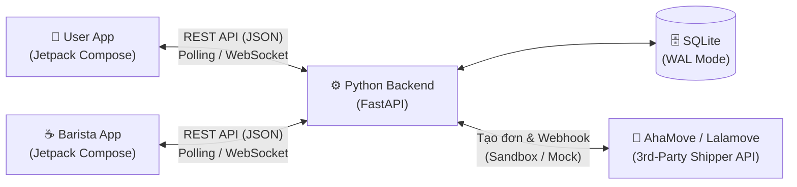

# ☕ D2C F&B Platform — Coffee Shop App

> Đồ án cuối kỳ môn **Phát triển ứng dụng di động** (HK1 / 2026–2027)  
> Nền tảng đặt món và điều phối giao hàng tự động (D2C) dành riêng cho ngành F&B với 2 vai trò song song: **Khách hàng (User)** và **Quầy Pha Chế (Barista)**.

---

## 🧭 Kiến trúc tổng quan



---

## 📁 Cấu trúc Monorepo

```text
Final/
├── android/            # 📱 Frontend — Ứng dụng Android (Kotlin, Jetpack Compose, MVVM)
│   └── README.md       #    Hướng dẫn chi tiết Frontend & tích hợp API
├── BE/                 # ⚙️ Backend — Python REST API + SQLite + Shipper Integration
│   └── README.md       #    Đặc tả hệ thống, DB, API Endpoints & tích hợp AhaMove/Lalamove
├── .gitignore          # 🙈 Quy tắc bỏ qua file tạm (Python, SQLite, OS)
└── README.md           # 📄 Tài liệu tổng quan dự án (file hiện tại)
```

---

## 🛠️ Công nghệ sử dụng

| Thành phần | Công nghệ | Ghi chú | Tài liệu |
| :--- | :--- | :--- | :--- |
| **Frontend (Mobile)** | Kotlin, Jetpack Compose (Material 3), MVVM | Đã hoàn thiện UI/UX với Mock Data | [android/README.md](android/README.md) |
| **Backend (API)** | Python 3.10+, FastAPI, REST API | Tự động sinh Swagger UI tại `/docs` | [BE/README.md](BE/README.md) |
| **Database** | SQLite (SQLAlchemy / SQLModel) | Nhẹ, dễ đóng gói & demo | [BE/README.md](BE/README.md) |
| **Giao hàng (3rd-Party)** | AhaMove / Lalamove API (hoặc Mock) | Nhận Webhook cập nhật tài xế | [BE/README.md](BE/README.md) |

---

## 🚀 Hướng dẫn chạy nhanh toàn hệ thống

### Bước 1: Khởi động Backend (`BE/`)
Xem hướng dẫn chi tiết trong [BE/README.md](BE/README.md).
```bash
cd BE
uvicorn main:app --host 0.0.0.0 --port 8000 --reload
```
* Kiểm tra API Docs tại: `http://localhost:8000/docs`

### Bước 2: Chạy Frontend (`android/`)
Xem hướng dẫn chi tiết trong [android/README.md](android/README.md).
1. Mở **Android Studio** -> **Open** -> chọn đúng thư mục **`Final/android`** *(không mở thư mục `Final/` bên ngoài)*.
2. Cấu hình `BASE_URL` trỏ về Backend:
   * **Android Emulator:** `http://10.0.2.2:8000/`
   * **Điện thoại thật (cùng Wi-Fi):** `http://<IP-LAN-máy-chạy-BE>:8000/`
3. Nhấn **Run** để chạy ứng dụng.

---

## 🔗 Nguyên tắc kết nối FE ↔ BE
* Hai thư mục `android/` và `BE/` **độc lập về mã nguồn**, giao tiếp hoàn toàn qua **HTTP/REST API (JSON)** (và Polling/WebSocket cho cập nhật trạng thái đơn).
* Chỉ cần thống nhất **JSON Contract** và **`BASE_URL`** là hai bên ghép nối trơn tru.
